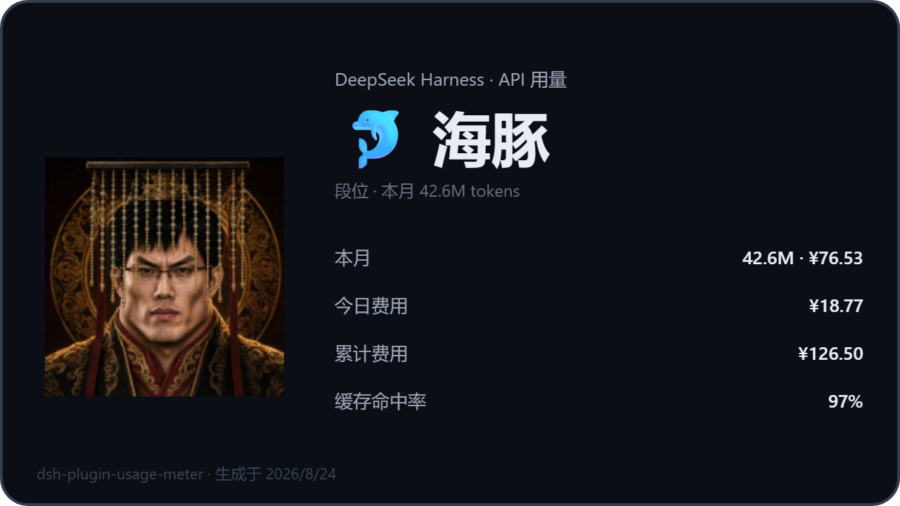

# dsh-plugin-usage-meter

<p align="center">
  
  &nbsp;
  
  &nbsp;
  
  &nbsp;
  
  &nbsp;
  
</p>

<p align="center">
  <strong>DeepSeek Harness 网页插件 · API 用量 / 费用 / 余额仪表</strong><br>
  <em>约 0.6MB 纯 Web 插件 · 比桌面版轻量一个数量级 · 官方账单自动接入 · 按钮式用量条实时报价 · 消耗段位 + 梁祖分享卡片 · 历史价生效区间计价 · 上下文压力预警</em>
</p>

<div align="center">

[是什么](#是什么) · [为什么比桌面版轻量](#为什么比桌面版轻量) · [项目优点](#项目优点) · [功能特性](#功能特性) · [界面预览](#界面预览) · [快速开始](#快速开始) · [设置](#设置) · [定价说明](#定价说明) · [数据与隐私](#数据与隐私) · [常见问题](#常见问题) · [已知限制](#已知限制)

</div>

## 是什么

一个纯社区维护的 DeepSeek Harness（dsh）网页插件：在输入框下方放一个**按钮样式的用量条**，实时显示当前会话的 token 用量、按 DeepSeek 官方刊例价（峰谷 × 双币种）估算的费用与**账户余额**；点开面板能看到当日/近 7 天**按模型堆叠的柱状图**、模型分布、上下文压力预警、**本月消耗段位（🦐→🐋 五档，最高为梁祖）**、预算进度与余额，并支持一键生成**梁祖分享卡片**与插件**检查更新/一键更新**。跨会话用量持久化成本地账本，历史费用**按刊例价生效区间计价**（官方调价前后的天数各按当时价估算）。

| 能力 | 原生 dsh web | 装本插件后 |
| --- | --- | --- |
| 会话 token / 费用 | 内置 token 统计（无费用） | 实时估算费用 + 今日累计 + 余额，按钮化可展开 |
| 峰谷计价 | 无 | 高峰/空闲双时段，CNY/USD 双币种 |
| 用量可视化 | 无 | 当日小时级 / 近 7 天按模型堆叠柱状图 |
| 历史价生效区间 | 无 | 官方调价前后按各自生效区间计价，调价自动识别 |
| 官方账单 | 无 | 读取 platform.deepseek.com 按日账单（今日/本月真实扣费，需平台 token） |
| 模型费用分布 | 无 | 事件级归属，跨会话累计 |
| 账户余额 | 无 | 官方余额接口 + 30s 缓存 + 手动刷新，按钮上直接显示 |
| 预算提醒 | 无 | 每日预算进度条，≥80% 黄、超支红 |
| 上下文压力 | 无 | 30% / 50% / 85% 三档变色预警 + 一键 /compact |
| 消耗段位 | 无 | 按本月 tokens 五档段位 + 梁祖分享卡片（canvas 导出 PNG） |
| 插件更新 | 无 | 面板内检查 npm 最新版 + 一键更新 |
| 跨会话账本 | 无 | 按天×模型、当日按小时×模型，原子持久化 |

数据来自 provider 上报的真实用量（内置 `tokenUsage` 会话投影），不依赖任何第三方服务；插件走官方 profile 机制挂载，不改 dsh 源码，卸载即还原。

## 为什么比桌面版轻量

市面上不少用量/费用工具以**桌面端形态**交付（Electron/Tauri 壳、独立窗口、自带更新器）。它们能做的事这里都能做，但代价差一个数量级——本插件是**纯 Web 插件**，寄生于 Harness 本身：

| 维度 | 桌面版（Electron/Tauri 壳 · 独立客户端） | dsh-plugin-usage-meter |
| --- | --- | --- |
| 安装体积 | 几十 ~ 上百 MB（安装包 + 运行时） | **约 0.6 MB** npm 包（10 个文件，含图标与预览图） |
| 运行开销 | 独立进程 + 常驻窗口，Electron 空壳内存普遍 100–300 MB | **0 额外进程、0 额外内存**：宿主半体在 Harness 进程内，前端只是网页里的一个小按钮 |
| 安装 / 卸载 | 安装器 / 卸载器、注册表、残留风险 | 一行 `dsh plugin add / remove`，重启即生效/即还原，**不碰系统** |
| 更新 | 下载安装包或依赖自家更新器 | 面板内检查 npm 最新版 + 一键更新（10 分钟缓存） |
| 跨平台 | 按系统各自打包、各自维护 | 纯 Web 插件，**Harness 跑在哪它就跟到哪**（Windows/macOS/Linux/WSL） |
| 可审计性 | 打包产物难以逐行核对 | MIT 开源、源码即所得（`lib/index.js` + `lib/client.js`）、无遥测、无第三方运行时依赖 |

## 项目优点

- 🪶 **极致轻量**：约 0.6MB、无 Electron、无独立进程、无遥测——装完几乎感觉不到它的存在
- 🧾 **官方账单零配置自动接入**：从本机浏览器自动读取平台 token，直接显示 platform.deepseek.com 的真实扣费（今日/累计/近 7 天），无需手动粘贴
- 🗓️ **计价最贴近真实**：官方价每日自动同步 + 调价按生效区间计价 + 当日逐小时 × 峰谷档位
- 🏆 **段位 + 梁祖分享卡片**：五档消耗段位，一键生成含梁祖吉祥物的 640×360 分享卡（canvas 导出 PNG）
- 🧠 **上下文压力三档预警 + 一键压缩**：30% / 50% / 85% 变色，一键 `/compact`
- 🔄 **面板内自更新**：检查 npm 最新版、一键升级、失败自动重试
- 🔒 **本地优先**：账本只存 token 桶与模型名、原子写入、自动清理；余额/账单仅直连 DeepSeek 官方接口

## 功能特性

- ⚡ **实时费用 + 余额按钮**：输入框下方一行 `峰 API ↑输入 ↓输出 ≈费用 · 今日 ¥X · 余额 ¥Y`，随流式输出实时刷新；按钮前缀**「峰 / 谷」时段标签**——高峰橙色、空闲绿色，悬停显示具体时段（北京时间 09:00–12:00、14:00–18:00 为高峰）
- 📊 **用量分布柱状图**：
  - **当日（默认）**：24 小时级柱状图，横轴每 3 小时标注
  - **近 7 天**：每日柱状图，一键切换（**每日按当天生效的刊例价计价**）
  - **颜色区分模型、同段多模型自动堆叠**，悬停查看每段费用与 token 明细，底部带颜色图例
- 🧮 **按模型分布**：各模型费用与 token 占比（事件级归属，跨会话累计），一眼看出哪个模型最烧钱
- 🗓️ **历史价按生效区间计价**：宿主把每次官方价变化记录为带日期的生效区间快照（内置 2026-08-17 快照兜底）；近 7 天柱状图、本月与累计费用逐日按当时生效价估算，官方调价自动识别、无需升级
- 🏔️ **峰谷计价 · 官方价自动同步**：每天自动解析官方定价页，调价无需升级插件即生效（失败回退内置快照）；高峰时段（UTC 01:00–04:00、06:00–10:00，即北京时间 09:00–12:00、14:00–18:00，仅工作日）为空闲时段 2 倍；**当日按小时 × 该小时档位计价**（日内峰谷不再同价）
- 🧾 **官方账单**（可选的 `DEEPSEEK_PLATFORM_TOKEN`）：读取 platform.deepseek.com 控制台的按日账单接口——**今日/累计显示官方真实扣费**（绿色「官方」标），近 7 天柱状图直接画官方每日费用，估算值降级为小字参考；未配置 token 时退回刊例价估算
- 💱 **双币种**：CNY / USD 官方报价，不做汇率换算（与官方账单口径一致）
- 💰 **账户余额**：查询官方余额接口，**30s 缓存** + 手动刷新，查询带 10s 超时不会拖慢面板；余额同时显示在按钮上
- 🧠 **上下文压力三档预警**：占用 30% 起变黄、50% 起橙色、85% 起红色（附「宽裕/偏高/紧张/危险」文字）；≥30% 时出现**「压缩」按钮**，一键把 `/compact` 放进输入框，回车即压缩上下文
- 🏆 **消耗段位 + 梁祖分享卡片**：按本月 tokens 分五档——🦐 虾米 <1M、🐟 小鱼 1M–10M、🐬 海豚 10M–50M、🐳 鲸鱼 50M–200M、**🐋 梁祖 ≥200M**；面板显示当前段位与距下一档进度，点「分享卡片」用 canvas 现场绘制含梁祖吉祥物的 640×360 卡片，一键保存 PNG
- 🔄 **检查更新 / 一键更新**：面板内查询 npm 最新版，有新版本时一键 `dsh plugin add` 更新自身（完成后提示重启 Harness）
- 🧾 **跨会话账本**：宿主监听 `session/event` 增量折叠，原子写入（tmp + rename 防写坏），自动清理
- 🎯 **预算提醒**：设置每日预算后，费用越接近预算颜色越醒目（≥80% 黄、超支红）
- 🌐 **中英双语**：界面文案随 harness 语言自动切换

## 界面预览

输入框下方，按钮样式的用量条（点击展开面板）：


梁祖分享卡片（面板「分享卡片」按钮生成，可直接保存 PNG）：



## 快速开始

### 系统要求

- 已安装 DeepSeek Harness，`dsh web` 可正常启动
- 余额查询需要 DeepSeek API Key（Web「模型」页写入的 `DEEPSEEK_API_KEY`；不配也能用除余额外的全部功能）

### 从 npm 安装（推荐）

```sh
dsh plugin --profile web add dsh-plugin-usage-meter
```

[npm 包地址](https://www.npmjs.com/package/dsh-plugin-usage-meter) · 装完重启 `dsh web` 并刷新页面，输入框下方出现按钮式用量条即生效。

> 插件自带 `dsh.bundle.patch`，`dsh plugin` 会把它自动注册进 profile 的 bundle 层，**无需手动编辑 `cordis.patch.yml`**。

### 从 GitHub 仓库安装

```sh
dsh plugin --profile web add github:fancr-code/dsh-plugin-usage-meter
```

或克隆后本地链接：

```sh
git clone https://github.com/fancr-code/dsh-plugin-usage-meter.git
dsh plugin --profile web add ./dsh-plugin-usage-meter
```

### 验证与卸载

- 验证：重启后输入框下方出现用量条即生效；也可 `dsh --profile web --dump-config` 确认 `usage-meter` 层已挂载
- 卸载：`dsh plugin --profile web remove dsh-plugin-usage-meter`，重启 `dsh web`（bundle 列表自动清理，无需手改配置）

## 设置

编辑 `$DSH_HOME/settings.yaml`（`usage-meter:` 节，全部可选）：

```yaml
usage-meter:
  currency: USD        # CNY（默认）或 USD
  budget: 50           # 每日预算（按上面币种），0 或省略 = 关闭提醒
  pricing:             # 可选：覆盖某模型单价（人民币 / 1M tokens）
    deepseek-v4-flash:
      peak:    { cacheMissInput: 3.0, cacheHitInput: 0.10, output: 9.0 }
      offPeak: { cacheMissInput: 1.5, cacheHitInput: 0.05, output: 4.5 }
```

| 字段 | 说明 |
| --- | --- |
| `currency` | 计费币种：`CNY` / `USD` |
| `budget` | 每日预算金额；`0` 或不写 = 关闭预算提醒 |
| `pricing.<模型>.peak / offPeak` | 覆盖刊例价（人民币/1M tokens，美元按 6.82 折算）；`cacheMissInput` 输入未命中、`cacheHitInput` 输入命中、`output` 输出 |

### 官方账单（可选，推荐）

API Key 只能查余额，**读不了后台账单**。插件支持两种方式接入平台账单（platform.deepseek.com 控制台同源数据）：

**方式一：自动从本机浏览器导入（默认，零配置）**——保持本机 Edge/Chrome 登录 platform.deepseek.com，插件直接从浏览器 Local Storage 读出 `userToken`（只在本机读取、只发往 platform.deepseek.com，不落账本）。重新登录平台后无需任何操作，自动拿到新 token。

**方式二：手动粘贴**——F12 → Application（应用）→ Local Storage → 复制 `userToken`，写入 `$DSH_HOME/.credentials.yaml`（与 `DEEPSEEK_API_KEY` 并列）：

```yaml
DEEPSEEK_PLATFORM_TOKEN: <粘贴 userToken>
```

> 禁用自动导入：环境变量 `USAGE_METER_AUTO_PLATFORM_TOKEN=0`。token 过期（平台报 40002/40003）自动退回估算，并冷却 30 分钟后自动重试/重扫。

生效后面板「今日累计 / 累计」显示绿色「官方」标与真实扣费，近 7 天柱状图直接画官方每日费用（10 分钟缓存，点「刷新」立即更新）。

## 定价说明

**自动同步官方刊例价 + 生效区间历史**：宿主每天自动抓取并解析 DeepSeek 官方定价页（[api-docs.deepseek.com/quick_start/pricing](https://api-docs.deepseek.com/quick_start/pricing)，美元/1M tokens，人民币按固定比例折算）。官方调价后**无需更新插件即自动生效**，且调价前后的历史用量会**各自按当时生效的刊例价估算**（账本保存 ≤24 个生效区间快照，内置 2026-08-17 快照兜底）。价格优先级：**settings.yaml 覆盖 > 官方生效区间/实时 > 内置快照**（面板页脚会标注当前来源与同步日期；存在多段生效区间时标注区间数）。

官方高峰规则（2026-08 起）：**UTC 01:00–04:00、06:00–10:00（即北京时间 09:00–12:00、14:00–18:00），仅周一至周五**；其余时间为空闲价（高峰为空闲 2 倍）。当前参考价格：

| 模型 | 时段 | 输入（未命中） | 输入（命中） | 输出 |
| --- | --- | ---: | ---: | ---: |
| deepseek-v4-flash | 高峰 | $0.44（≈¥3.0） | $0.014（≈¥0.10） | $1.32（≈¥9.0） |
| deepseek-v4-flash | 空闲 | $0.22（≈¥1.5） | $0.007（≈¥0.05） | $0.66（≈¥4.5） |
| deepseek-v4-pro | 高峰 | $1.32（≈¥9.0） | $0.044（≈¥0.30） | $3.96（≈¥27.0） |
| deepseek-v4-pro | 空闲 | $0.66（≈¥4.5） | $0.022（≈¥0.15） | $1.98（≈¥13.5） |

- `deepseek-chat` → flash、`deepseek-reasoner` → pro 视为别名；未定价模型按 flash 估算并在面板标注
- **当日用量按小时 × 该小时峰谷档位计价**；历史天（近 7 天 / 本月 / 累计）按各日生效区间刊例价估算、**日内峰谷差异不追溯**（配置平台 token 后历史天直接显示官方账单）

## 数据与隐私

- 账本位置：`$DSH_HOME/usage-meter/ledger.json`，只存 token 桶、模型名与刊例价生效区间快照，**不含对话内容**
- 写入策略：2s 防抖 + 原子写入（临时文件 + rename），崩溃不损坏账本
- 自动清理：按天数据保留 180 天、当日小时数据跨天即清、90 天前的零用量会话条目删除
- 余额接口直连 `api.deepseek.com`（跟随 `$DEEPSEEK_BASE_URL`），API Key 走 harness 凭证服务，不落账本
- 检查更新直连 `registry.npmjs.org`（10 分钟缓存）；一键更新调用 `dsh plugin add`，仅在你点击「更新」后执行

## 常见问题

<details>
<summary><strong>装完重启了，输入框下面没有用量条？</strong></summary>

先确认装进了 `web` profile（`--profile web`），再 `dsh --profile web --dump-config` 确认 `usage-meter` 层已挂载；页面刷新不够，要重启 `dsh web` 进程。
</details>

<details>
<summary><strong>为什么近 7 天的柱状图里有灰色的「未识别模型」？</strong></summary>

那是升级到 1.2.0（按模型记账）之前的历史天：旧账本只有总量、没有模型拆分，插件用灰色段兜底展示。新产生的用量会带正确的模型颜色。
</details>

<details>
<summary><strong>费用数字和官方账单对不上？</strong></summary>

面板是**估算值**：日内峰谷差异不追溯，但历史天会按各自生效区间刊例价计价（官方调价自动识别）；刊例价每天自动同步官方页（失败时用内置快照），也可在设置里用 `pricing` 覆盖。以官方账单为准。
</details>

<details>
<summary><strong>「压缩」按钮点了没反应？</strong></summary>

按钮会把 `/compact` 放进输入框（个别环境取不到输入框时会复制到剪贴板），按回车发送即触发压缩；会话忙碌时官方会提示稍后再试。
</details>

<details>
<summary><strong>余额显示「未配置余额 API Key」？</strong></summary>

到 Web「模型」页写入 `DEEPSEEK_API_KEY`（或设置环境变量），面板里点「刷新」。不配 Key 不影响其余功能。
</details>

<details>
<summary><strong>「更新」点了之后要做什么？</strong></summary>

面板内更新会执行 `dsh plugin add dsh-plugin-usage-meter` 升级到 npm 最新版，完成后**重启 Harness 生效**（托盘菜单 → 重启 Harness，或重启 `dsh web`）。
</details>

<details>
<summary><strong>换了模型，费用还是按旧模型算？</strong></summary>

面板按当前会话最近一次请求的模型计价，模型切换后下一次流式输出会自动更新；未定价模型按 flash 估算。
</details>

## 已知限制

- 费用为**估算值**：当日按小时 × 峰谷档位计价；历史天按生效区间刊例价估算、日内峰谷不追溯（配置平台 token 后历史天直接显示官方账单）；以官方账单为准
- 官方账单接口来自 platform.deepseek.com 控制台，token 过期或平台改版时自动退回估算
- 账本从插件安装时开始累计（含安装时已打开会话的历史，通过启动回填），不追溯更早的存档会话
- 生效区间快照的起点是插件**首次观测到该价表的日子**（官方公布日与观测日可能相差数天）
- 余额查询失败（未配置 Key / 网络）在面板内静默降级为「—」，不弹错
- 柱状图的「当日」视图为小时粒度；跨午夜后昨日小时数据即清理，不保留更细颗粒度
- 未定价模型统一按 flash 估算，费用可能被低估

## 许可

MIT © 2026 fancr-code

## 致谢

- 插件形态参照官方 `@deepseek-ai/dsh-*` 包与社区 dsh-web-ui 全家桶的 bundle 自注册机制
- 峰谷刊例价取自 DeepSeek 官方定价页（2026-08-17 快照）
- 分享卡片吉祥物「梁祖」为 fancr-code 自绘素材，与 Liang-Saint-Slider 同源
