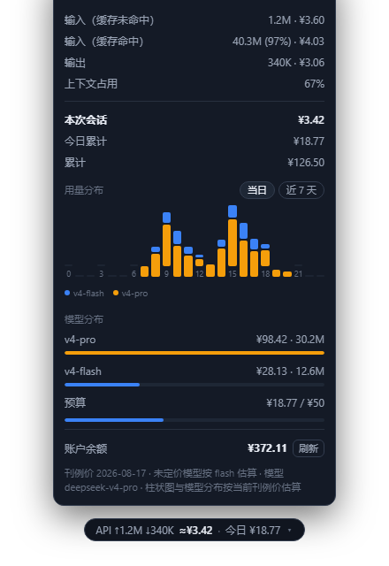

# dsh-plugin-usage-meter

<p align="center">
  
  &nbsp;
  
  &nbsp;
  
  &nbsp;
  
  &nbsp;
  
</p>

<p align="center">
  <strong>DeepSeek Harness 网页插件 · API 用量 / 费用 / 余额仪表</strong><br>
  <em>按钮式用量条实时报价 · 当日/近 7 天按模型堆叠柱状图 · 预算提醒 · 跨会话账本</em>
</p>

<div align="center">

[是什么](#是什么) · [功能特性](#功能特性) · [界面预览](#界面预览) · [快速开始](#快速开始) · [设置](#设置) · [定价说明](#定价说明) · [数据与隐私](#数据与隐私) · [常见问题](#常见问题) · [已知限制](#已知限制)

</div>

## 是什么

一个纯社区维护的 DeepSeek Harness（dsh）网页插件：在输入框下方放一个**按钮样式的用量条**，实时显示当前会话的 token 用量与按 DeepSeek 官方刊例价（峰谷 × 双币种）估算的费用；点开面板能看到当日/近 7 天**按模型堆叠的柱状图**、模型分布、上下文占用、账户余额与预算进度，并把跨会话用量持久化成本地账本。

| 能力 | 原生 dsh web | 装本插件后 |
| --- | --- | --- |
| 会话 token / 费用 | 内置 token 统计（无费用） | 实时估算费用 + 今日累计，按钮化可展开 |
| 峰谷计价 | 无 | 高峰/空闲双时段，CNY/USD 双币种 |
| 用量可视化 | 无 | 当日小时级 / 近 7 天按模型堆叠柱状图 |
| 模型费用分布 | 无 | 事件级归属，跨会话累计 |
| 账户余额 | 无 | 官方余额接口 + 60s 缓存 + 手动刷新 |
| 预算提醒 | 无 | 每日预算进度条，≥80% 黄、超支红 |
| 跨会话账本 | 无 | 按天×模型、当日按小时×模型，原子持久化 |

数据来自 provider 上报的真实用量（内置 `tokenUsage` 会话投影），不依赖任何第三方服务；插件走官方 profile 机制挂载，不改 dsh 源码，卸载即还原。

## 功能特性

- ⚡ **实时费用**：输入框下方一行 `API ↑输入 ↓输出 ≈费用 · 今日 ¥X`，随流式输出实时刷新
- 📊 **用量分布柱状图**：
  - **当日（默认）**：24 小时级柱状图，横轴每 3 小时标注
  - **近 7 天**：每日柱状图，一键切换
  - **颜色区分模型、同段多模型自动堆叠**，悬停查看每段费用与 token 明细，底部带颜色图例
- 🧮 **按模型分布**：各模型费用与 token 占比（事件级归属，跨会话累计），一眼看出哪个模型最烧钱
- 🏔️ **峰谷计价**：按 DeepSeek 官方刊例价，高峰时段（北京时间 09:00–12:00、14:00–18:00）为空闲时段 2 倍
- 💱 **双币种**：CNY / USD 官方报价，不做汇率换算（与官方账单口径一致）
- 💰 **账户余额**：查询官方余额接口，60s 缓存 + 手动刷新，查询带 10s 超时不会拖慢面板
- 🧾 **跨会话账本**：宿主监听 `session/event` 增量折叠，原子写入（tmp + rename 防写坏），自动清理
- 🎯 **预算提醒**：设置每日预算后，费用越接近预算颜色越醒目（≥80% 黄、超支红）
- 🌐 **中英双语**：界面文案随 harness 语言自动切换

## 界面预览

输入框下方，按钮样式的用量条（点击展开面板）：



## 快速开始

### 系统要求

- 已安装 DeepSeek Harness，`dsh web` 可正常启动
- 余额查询需要 DeepSeek API Key（Web「模型」页写入的 `DEEPSEEK_API_KEY`；不配也能用除余额外的全部功能）

### 三步上手

1. 安装插件（[npm](https://www.npmjs.com/package/dsh-plugin-usage-meter)）：`dsh plugin --profile web add dsh-plugin-usage-meter`
2. 重启 `dsh web`，刷新页面
3. 输入框下方出现按钮式用量条，点击展开面板

> 插件自带 `dsh.bundle.patch`，`dsh plugin` 会把它自动注册进 profile 的 bundle 层，**无需手动编辑 `cordis.patch.yml`**。

### 从 GitHub 仓库安装

```sh
dsh plugin --profile web add github:fancr-code/dsh-plugin-usage-meter
```

或克隆后本地链接：

```sh
git clone https://github.com/fancr-code/dsh-plugin-usage-meter.git
dsh plugin --profile web add ./dsh-plugin-usage-meter
```

### 验证与卸载

- 验证：重启后输入框下方出现用量条即生效；也可 `dsh --profile web --dump-config` 确认 `usage-meter` 层已挂载
- 卸载：`dsh plugin --profile web remove dsh-plugin-usage-meter`，重启 `dsh web`（bundle 列表自动清理，无需手改配置）

## 设置

编辑 `$DSH_HOME/settings.yaml`（`usage-meter:` 节，全部可选）：

```yaml
usage-meter:
  currency: USD        # CNY（默认）或 USD
  budget: 50           # 每日预算（按上面币种），0 或省略 = 关闭提醒
  pricing:             # 可选：覆盖某模型单价（人民币 / 1M tokens）
    deepseek-v4-flash:
      peak:    { cacheMissInput: 3.0, cacheHitInput: 0.10, output: 9.0 }
      offPeak: { cacheMissInput: 1.5, cacheHitInput: 0.05, output: 4.5 }
```

| 字段 | 说明 |
| --- | --- |
| `currency` | 计费币种：`CNY` / `USD` |
| `budget` | 每日预算金额；`0` 或不写 = 关闭预算提醒 |
| `pricing.<模型>.peak / offPeak` | 覆盖刊例价（人民币/1M tokens，美元按 6.82 折算）；`cacheMissInput` 输入未命中、`cacheHitInput` 输入命中、`output` 输出 |

## 定价说明

按 DeepSeek 官方 2026-08-17 刊例价（每 1M tokens，人民币），高峰时段（北京时间 09:00–12:00、14:00–18:00）为空闲时段的 2 倍：

| 模型 | 时段 | 输入（未命中） | 输入（命中） | 输出 |
| --- | --- | ---: | ---: | ---: |
| deepseek-v4-flash | 高峰 | ¥3.0 | ¥0.10 | ¥9.0 |
| deepseek-v4-flash | 空闲 | ¥1.5 | ¥0.05 | ¥4.5 |
| deepseek-v4-pro | 高峰 | ¥9.0 | ¥0.30 | ¥27.0 |
| deepseek-v4-pro | 空闲 | ¥4.5 | ¥0.15 | ¥13.5 |

- `deepseek-chat` → flash、`deepseek-reasoner` → pro 视为别名；未定价模型按 flash 估算并在面板标注
- 柱状图与模型分布按**当前时段刊例价**估算（历史时段的峰谷差异不追溯）

## 数据与隐私

- 账本位置：`$DSH_HOME/usage-meter/ledger.json`，只存 token 桶与模型名，**不含对话内容**
- 写入策略：2s 防抖 + 原子写入（临时文件 + rename），崩溃不损坏账本
- 自动清理：按天数据保留 180 天、当日小时数据跨天即清、90 天前的零用量会话条目删除
- 余额接口直连 `api.deepseek.com`（跟随 `$DEEPSEEK_BASE_URL`），API Key 走 harness 凭证服务，不落账本

## 常见问题

<details>
<summary><strong>装完重启了，输入框下面没有用量条？</strong></summary>

先确认装进了 `web` profile（`--profile web`），再 `dsh --profile web --dump-config` 确认 `usage-meter` 层已挂载；页面刷新不够，要重启 `dsh web` 进程。
</details>

<details>
<summary><strong>为什么近 7 天的柱状图里有灰色的「未识别模型」？</strong></summary>

那是升级到 1.2.0（按模型记账）之前的历史天：旧账本只有总量、没有模型拆分，插件用灰色段兜底展示。新产生的用量会带正确的模型颜色。
</details>

<details>
<summary><strong>费用数字和官方账单对不上？</strong></summary>

面板是**实时估算**：按当前时段刊例价计算，不追溯历史峰谷；刊例价可能滞后于官方调价，可在设置里用 `pricing` 覆盖。以官方账单为准。
</details>

<details>
<summary><strong>余额显示「未配置余额 API Key」？</strong></summary>

到 Web「模型」页写入 `DEEPSEEK_API_KEY`（或设置环境变量），面板里点「刷新」。不配 Key 不影响其余功能。
</details>

<details>
<summary><strong>换了模型，费用还是按旧模型算？</strong></summary>

面板按当前会话最近一次请求的模型计价，模型切换后下一次流式输出会自动更新；未定价模型按 flash 估算。
</details>

## 已知限制

- 费用为**估算值**：不追溯历史峰谷时段差异，刊例价快照可能滞后官方调价，以官方账单为准
- 账本从插件安装时开始累计（含安装时已打开会话的历史，通过启动回填），不追溯更早的存档会话
- 余额查询失败（未配置 Key / 网络）在面板内静默降级为「—」，不弹错
- 柱状图的「当日」视图为小时粒度；跨午夜后昨日小时数据即清理，不保留更细颗粒度
- 未定价模型统一按 flash 估算，费用可能被低估

## 许可

MIT © 2026 fancr-code

## 致谢

- 插件形态参照官方 `@deepseek-ai/dsh-*` 包与社区 dsh-web-ui 全家桶的 bundle 自注册机制
- 峰谷刊例价取自 DeepSeek 官方定价页（2026-08-17 快照）
